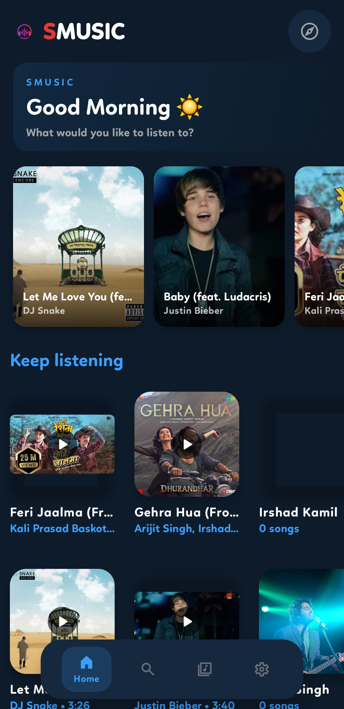
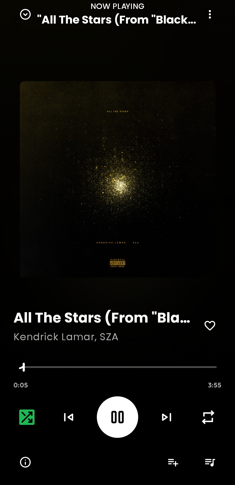
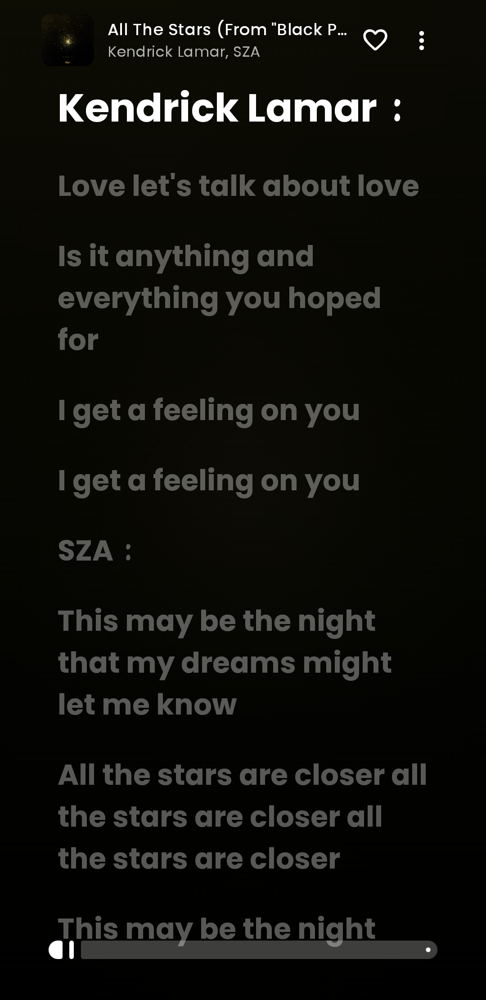
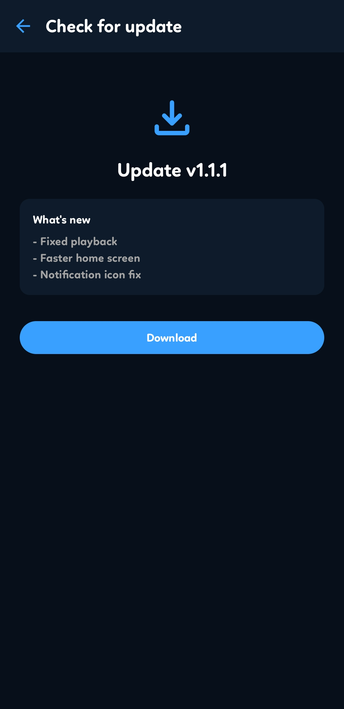

<div align="center">


# 🎧 ListenO

**Stream, download, and enjoy music — free, ad-free, and open source for Android.**

[](release/ListenO-v1.2.0.apk)
[-success?style=flat-square&logo=android)](release/ListenO-v1.2.0.apk)
[](LICENSE.txt)
[](https://developer.android.com)
[](https://developer.android.com/jetpack/compose)

<br/>

<a href="release/ListenO-v1.2.0.apk">
  
</a>
&nbsp;&nbsp;
<a href="https://raw.githubusercontent.com/suvo1119/ListenO/main/release/ListenO-v1.2.0.apk">
  
</a>

</div>

---

## 📥 Get the Release APK

You can download and install ListenO directly on your Android phone without any app store:

| Distribution | Link | Size | Minimum Android |
|---|---|---|---|
| **Release APK (v1.2.0)** | [📥 **Download ListenO-v1.2.0.apk**](release/ListenO-v1.2.0.apk) | `~9.4 MB` | Android 7.0+ (API 24+) |
| **Direct GitHub Raw Download** | [⚡ **Direct Raw APK Download**](https://raw.githubusercontent.com/suvo1119/ListenO/main/release/ListenO-v1.2.0.apk) | `~9.4 MB` | Android 7.0+ (API 24+) |
| **Repository Location** | [`release/ListenO-v1.2.0.apk`](release/ListenO-v1.2.0.apk) or [`app/release/app-release.apk`](app/release/app-release.apk) | `~9.4 MB` | Android 7.0+ (API 24+) |

### 📲 Quick Installation Steps
1. Tap the **Download Release APK** button above or download [`release/ListenO-v1.2.0.apk`](release/ListenO-v1.2.0.apk).
2. When the download completes, tap the APK file in your notification bar or downloads folder.
3. If prompted by Android, allow **"Install unknown apps"** for your browser or file manager.
4. Tap **Install** and open ListenO to start listening instantly!

---

## 📑 Table of Contents

- [About](#about)
- [Screenshots](#screenshots)
- [Core Features](#core-features)
  - [Playback & Engine](#-playback--engine)
  - [Offline Downloads](#-offline-downloads)
  - [Real-time Synced Lyrics](#-real-time-synced-lyrics)
  - [11 In-App Player Styles & Theming](#-11-in-app-player-styles--theming)
  - [Discovery & Playlist Import](#-discovery--playlist-import)
  - [Music Recognition](#-music-recognition)
  - [Library & Listening Stats](#-library--listening-stats)
- [Tech Stack](#tech-stack)
- [Project Architecture & Modules](#project-architecture--modules)
- [Building From Source](#building-from-source)
- [Frequently Asked Questions](#frequently-asked-questions)
- [Contributing](#contributing)
- [Security](#security)
- [License](#license)

---

## About

**ListenO** is an elegant, feature-packed, and completely ad-free Android music player. Powered by YouTube Music's massive catalog, it gives you high-fidelity audio streaming, full offline downloads, real-time synchronized lyrics, music recognition, and an unprecedented **11 swappable player styles** designed with modern Jetpack Compose Material 3 Expressive aesthetics.

No paid subscriptions, no intrusive ads, and no account required. Everything runs locally on your device with clean, direct communication to YouTube Music's InnerTube API.

---

## Screenshots

<p align="center">
  
  &nbsp;&nbsp;
  
  &nbsp;&nbsp;
  
</p>

<p align="center">
  
  &nbsp;&nbsp;
  
  &nbsp;&nbsp;
  
</p>

---

## Core Features

### 🎵 Playback & Engine
- **Vast Music Catalog**: Stream millions of tracks directly via YouTube Music without commercial interruptions.
- **Media3 / ExoPlayer Core**: Ultra-reliable, low-latency, and gapless audio engine.
- **Background & Lock-Screen Playback**: Native Android media session with notification controls, lock-screen artwork, and headset control support.
- **Home Screen Widget**: Control playback directly from your Android launcher.
- **Sleep Timer**: Built-in timer with countdown to pause playback automatically when you fall asleep.
- **Smart Queue & Shuffling**: Seamless queue management, shuffle, repeat one/all, and radio station generation based on any track.

### ⬇️ Offline Downloads
- **Store Locally**: Download individual tracks or full playlists directly to your device storage.
- **Persistent Storage**: Saved music persists across app updates with full local metadata and artwork caching.
- **Low Data Mode**: Automatically switches to data-saving audio quality when listening over cellular data.

### 📝 Real-time Synced Lyrics
- **Multi-Source Synchronization**: Automatically fetches accurate, synchronized lyrics from **LRCLIB**, **KuGou**, **BetterLyrics**, and YouTube captions.
- **Karaoke & Line Highlighting**: Smooth, animated line-by-line highlighting with instant tap-to-seek playback.
- **Lyric Quote Cards**: Generate and share beautifully styled lyric quote images directly to social media or friends.

### 🎨 11 In-App Player Styles & Theming
- **11 Unique Player Layouts**: Switch dynamically between **Classic**, **Spotify**, **Apple**, **Galaxy**, **Fold**, **Frost**, **Paper**, **Liquid**, **CloudGlow**, **Groove**, and **Popsy**.
- **Dynamic Color Science**: Utilizes Google's Material Color Utilities to dynamically adapt background gradients and accent colors based on the current song's album artwork.
- **Customizable Seekbars**: Choose between Default, animated **Squiggly Wave**, or Minimalist Slim seekbar designs.
- **Custom Navigation & Themes**: Dark mode, AMOLED black mode, custom theme presets, and reorderable bottom navigation bars.
- **Built-in Audio Equalizer**: Fine-tune your audio output with multi-band EQ presets.

### 🎤 Discovery & Playlist Import
- **Instant Playlist Import**: Migrate your existing playlists directly from Spotify and YouTube Music without losing your curated music.
- **Explore & Mood Categories**: Discover trending releases, regional hits, mood playlists, and genres.
- **Fast Search Engine**: Filter search results by songs, artists, albums, playlists, and community uploads.

### 🔍 Music Recognition
- **Built-in Audio Identifier**: Identify songs playing around you in the background with integrated ShazamKit recognition.

### 📊 Library & Listening Stats
- **Comprehensive Library**: Dedicated views for liked songs, artists, albums, and playlists.
- **Listening Insights**: Track your playback habits, top songs, and favorite artists over time.
- **Backup & Restore**: Easily export and restore your entire library, playlist structure, and settings with one tap.

---

## Tech Stack

- **Language**: [Kotlin](https://kotlinlang.org/) (100% Kotlin codebase)
- **UI Framework**: [Jetpack Compose](https://developer.android.com/jetpack/compose) with Material 3 Expressive
- **Audio Engine**: [AndroidX Media3 / ExoPlayer](https://developer.android.com/guide/topics/media/media3)
- **Architecture**: Clean Architecture with MVVM & MVI patterns
- **Dependency Injection**: [Dagger Hilt](https://dagger.dev/hilt/)
- **Local Storage**: [Room Database](https://developer.android.com/training/data-storage/room) & DataStore Preferences
- **Image Loading**: [Coil Compose](https://coil-kt.github.io/coil/)
- **Annotation Processing**: [KSP (Kotlin Symbol Processing)](https://kotlinlang.org/docs/ksp-overview.html)
- **Networking & API**: Custom InnerTube client for YouTube Music, Ktor / OkHttp, Kotlinx Serialization

---

## Project Architecture & Modules

```
ListenO/
├── app/                      # Main Android application (UI, Player, ViewModel, Database, Navigation)
├── innertube/                # YouTube Music API client & protobuf/JSON parsers
├── betterlyrics/             # BetterLyrics provider integration
├── lrclib/                   # LRCLIB synced lyrics integration
├── kugou/                    # KuGou lyrics search engine
├── shazamkit/                # Audio fingerprinting & music recognition module
├── jossredconnect/           # Authentication & backend connector
├── material-color-utilities/ # Google Material Design color extraction library
├── release/                  # Ready-to-install signed release APKs
└── docs/screenshots/        # UI screenshots & visual documentation
```

---

## Building From Source

### Prerequisites

- **Android Studio**: Ladybug (2024.2.1+) or newer
- **JDK**: Version 17 or higher
- **Android SDK**: `compileSdk 36`, `targetSdk 35`, `minSdk 24`

### Build Instructions

1. **Clone the repository:**
   ```bash
   git clone https://github.com/suvo1119/ListenO.git
   cd ListenO
   ```

2. **Configure SDK Path (Optional):**
   Ensure `local.properties` exists in the root folder with your Android SDK location:
   ```properties
   sdk.dir=/path/to/your/Android/Sdk
   github.repo=suvo1119/ListenO
   ```

3. **Build the Debug APK:**
   ```bash
   ./gradlew assembleDebug
   ```
   The APK will be generated at:
   `app/build/outputs/apk/debug/app-debug.apk`

4. **Build the Release APK:**
   ```bash
   ./gradlew assembleRelease
   ```
   *(To sign the release build, add your `keystore.properties` with `storeFile`, `storePassword`, `keyAlias`, and `keyPassword`)*

---

## Frequently Asked Questions

**Is ListenO completely free?**  
Yes. ListenO is 100% free and open-source under the GPL-3.0 license. There are no paid tiers, subscriptions, or hidden costs.

**Are there any advertisements?**  
No. There are zero ads, banners, or audio interruptions.

**Do I need to sign in with a Google or YouTube account?**  
No! ListenO works out of the box without any login required. You can search, stream, download, and manage playlists immediately.

**Why is ListenO not on Google Play Store?**  
Due to Google Play policies regarding third-party YouTube clients, ListenO is distributed directly through this GitHub repository. You can always grab the latest version from the [release folder](release/ListenO-v1.2.0.apk).

---

## Contributing

Contributions, bug reports, and feature suggestions are warmly welcomed! Please read our [CONTRIBUTING.md](CONTRIBUTING.md) guide for details on our code style, guidelines, and pull request workflow.

---

## Security

Please refer to our [SECURITY.md](SECURITY.md) for vulnerability disclosure guidelines.

---

## License

This project is licensed under the **GNU General Public License v3.0**. See the [LICENSE.txt](LICENSE.txt) file for full details.

```
Copyright (C) 2026 ListenO Contributors
Licensed under the GNU General Public License, Version 3.0.
```
